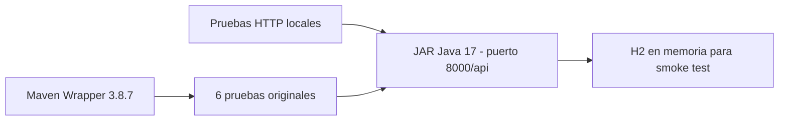
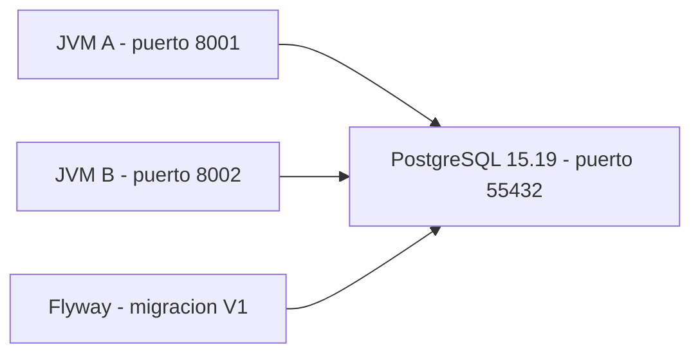
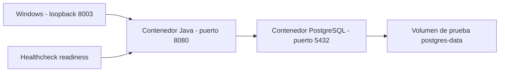
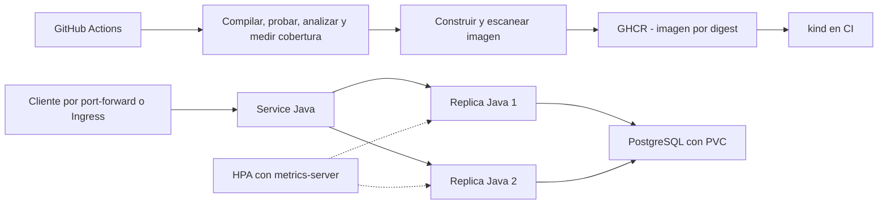

# Demo Devops Java

This is a simple application to be used in the technical test of DevOps.

## Prueba DevOps: estado verificable

**Etapa 1 completada el 20 de octubre de 2026, hora de El Salvador.** Se revisaron la aplicación y el entorno, se seleccionó Java 17 y se ejecutaron la compilación, las seis pruebas originales, el empaquetado y nueve comprobaciones HTTP del JAR. La captura de esa etapa conserva los hashes y resultados de la aplicación original.

**Persistencia compartida implementada y verificada:** PostgreSQL es el perfil predeterminado, con Flyway y `ddl-auto=validate`. En esa etapa, dos JVM conectadas a PostgreSQL 15.19 real aprobaron **36 comprobaciones de integración**, incluida lectura compartida, peticiones concurrentes y conservación de datos tras reiniciar A. Las JVM y PostgreSQL nativo quedaron detenidos.

**Etapa 2 completada el 21 de octubre de 2026:** imagen Docker multietapa, usuario 10001 y Actuator implementados. Pasaron **11 pruebas Maven** tanto en Windows como dentro de Docker Linux, nueve comprobaciones HTTP H2 del JAR y **39 comprobaciones del contenedor con PostgreSQL**. Se verificaron caída y recuperación de la BD sin reiniciar Java, persistencia tras reiniciar PostgreSQL y apagado ordenado. Dos construcciones limpias Linux produjeron el mismo JAR. El motor Docker ya funciona; los recursos de las pruebas quedaron eliminados y la imagen permanece local.

**Calidad completada el 23 de octubre de 2026:** 22 pruebas aprobadas, PMD sin infracciones y cobertura JaCoCo de **90,28 % de líneas** y **12,90 % de ramas** globales. El servicio tiene 100 % de líneas y ramas. Maven bloquea la construcción si fallan pruebas, PMD o los umbrales documentados. No se excluyeron clases para elevar artificialmente la cobertura.

Se prepararon GitHub Actions, publicación GHCR y Kubernetes privado con kind, dos réplicas, HPA, ConfigMap, Secret, PostgreSQL persistente e Ingress. Su ejecución completa y sus resultados remotos se verificarán antes de declarar terminada la entrega. **No se requiere un endpoint público**; la API se valida en localhost.

- [Diagnóstico, resultados y problemas encontrados](docs/DIAGNOSTICO.md).
- [Plan guiado para los siete días y preguntas de defensa](docs/PLAN-DE-TRABAJO.md).
- [Evidencia de la línea base](docs/evidence/baseline/README.md).
- [Guía de PostgreSQL compartido, perfiles y migraciones](docs/POSTGRESQL.md).
- [Evidencia de PostgreSQL con dos instancias](docs/evidence/postgres/README.md).
- [Guía de Docker, salud y ejecución con Compose](docs/DOCKER-Y-SALUD.md).
- [Evidencia de construcción y ejecución del contenedor](docs/evidence/docker-health/README.md).
- [Pruebas, PMD, cobertura y controles de calidad](docs/CALIDAD.md).
- [Evidencia de calidad y medición inicial](docs/evidence/quality/README.md).
- [Pipeline como código y ejecución local](docs/PIPELINE.md).
- [README original sin modificaciones](docs/evidence/baseline/README-original.md).

### Entorno identificado

| Componente | Resultado observado |
| --- | --- |
| Sistema | Windows 11 Home Single Language, x64, versión 10.0.26200; PowerShell 7.6.5 |
| CPU y memoria | Intel Core i7-13620H, 16 procesadores lógicos; 15,63 GiB RAM total y aproximadamente 1,2–1,3 GiB libres durante el diagnóstico |
| Disco C: | Aproximadamente 693 GiB libres |
| Java inicial | Oracle JDK 26; `JAVA_HOME` no definido |
| Java utilizado | Temurin JDK 17.0.20.1+1 portable; ZIP verificado por SHA-256 |
| Maven | Global 3.9.15; construcción con Maven 3.8.7 mediante Wrapper 3.3.4 y checksums fijados |
| Docker | Cliente y motor Linux 29.6.1; Docker Desktop 4.80.0 y Compose 5.1.4 comprobados en la etapa 2 |
| Kubernetes | kubectl 1.36.1 instalado; no hay contextos configurados |
| Otros | Git 2.54.0; WSL2 con distribución docker-desktop; kind, minikube, Helm, gh y Trivy ausentes de PATH |
| GitHub | Conector autenticado como `mpguevara`; creación de repositorio, push, GHCR y Actions aún sin verificar |

La copia inicial procede de un ZIP. El 23 de octubre se inicializó Git para registrar el trabajo real. Docker volvió a presentar sockets obsoletos; se recuperó conservando esos directorios como respaldo, sin restablecerlo ni borrar volúmenes. La memoria disponible del diagnóstico es una captura histórica; las validaciones actuales se ejecutan por separado y el nodo kind se limita a 4 GiB y cuatro CPU.

### Versiones y dependencias confirmadas

Se mantienen Java **17**, Spring Boot **3.0.5**, ModelMapper **2.4.5** y springdoc **2.1.0**. El proyecto incluye Web, JPA, Validation, Test, H2, Lombok y DevTools. El árbol inicial resuelto confirma Spring Framework **6.0.7**, Hibernate **6.1.7.Final**, H2 **2.1.214**, Lombok **1.18.26**, JUnit Jupiter **5.9.2** y Mockito **4.8.1**. Se añadieron PostgreSQL JDBC **42.7.14**, Flyway **9.5.1** y Actuator **3.0.5**. Se conservan el [árbol inicial](docs/evidence/baseline/dependency-tree.txt) y el [árbol de la etapa PostgreSQL, anterior a Actuator](docs/evidence/postgres/dependency-tree.txt).

Usaremos Java 17 para respetar la base entregada. La [documentación de Spring Boot 3.0.5](https://docs.spring.io/spring-boot/docs/3.0.5/reference/html/getting-started.html#getting-started.system-requirements) declara compatibilidad con Java 17–20; Java 26 queda fuera de ese rango. No se ejecutó ni se afirma una compilación fallida con Java 26.

### Preparación en Windows y ejecución local

Desde la raíz del proyecto, en PowerShell 7:

```powershell
# Descarga portable fuera del repositorio; no cambia la configuración global.
.\scripts\Install-Java17.ps1
. .\scripts\Use-Java17.ps1
.\mvnw.cmd -v

# Límite de heap usado en esta máquina durante la línea base.
$env:MAVEN_OPTS = '-Xmx384m -Dfile.encoding=UTF-8'
.\mvnw.cmd -B -ntp clean verify '-DargLine=-Xmx384m'
```

Si ya tienes otro JDK 17, selecciona su directorio mediante `Use-Java17.ps1 -JdkHome 'C:\ruta\al\jdk-17'`. El script valida que sea un JDK 17 completo. La selección afecta a la terminal actual y a sus procesos hijos. `MAVEN_OPTS` limita el heap de Maven y `argLine` el heap del proceso de pruebas; no representan el consumo total de memoria.

Para ejecutar el JAR con el perfil PostgreSQL predeterminado, prepara las tres variables de conexión y arranca solo PostgreSQL con el archivo Compose base:

```powershell
$env:USERNAME_DB = 'devsu'
$env:NAME_DB = 'jdbc:postgresql://127.0.0.1:5432/devsu'
$env:PASSWORD_DB = Read-Host -MaskInput 'Contraseña de PostgreSQL local'
docker compose up -d --wait
java -Xms64m -Xmx256m -jar .\target\demo-0.0.1.jar --server.address=127.0.0.1
```

También puedes usar `.\mvnw.cmd spring-boot:run` con esas variables y PostgreSQL accesible. La API queda en `http://127.0.0.1:8000/api/users` y Swagger en `http://127.0.0.1:8000/api/swagger-ui.html`. Flyway crea el esquema y PostgreSQL inicia sin los tres usuarios de demostración. No se importan automáticamente los datos del archivo H2. La [guía PostgreSQL](docs/POSTGRESQL.md) explica los perfiles, credenciales, volumen y alternativa nativa comprobada.

Para una comprobación aislada del JAR:

```powershell
.\scripts\Test-LocalApi.ps1
# Reporte: target/local-api-evidence/http-results.json
```

El script selecciona `local` explícitamente, inicia el JAR en loopback, usa H2 en memoria, comprueba GET/POST, errores esperados, Swagger y OpenAPI, y detiene exclusivamente el proceso que inició. Los datos de esta comprobación se descartan al terminar. Para probar dos JVM contra una BD PostgreSQL de prueba vacía, usa `scripts/Test-PostgresApi.ps1` siguiendo la [guía](docs/POSTGRESQL.md#repetir-la-verificación-entre-dos-instancias).

En Linux/macOS con JDK 17, los comandos equivalentes son `sh ./mvnw clean verify` y `sh ./mvnw spring-boot:run`. El Dockerfile ejecutó `./mvnw clean verify` sobre Linux; no se ha verificado la ejecución directa en macOS.

### Configuración actual

| Variable | Valor en perfil PostgreSQL | Función |
| --- | --- | --- |
| `PORT` | 8000 | Puerto HTTP; contexto fijo `/api` |
| `NAME_DB` | Obligatoria | URL JDBC PostgreSQL; no es solamente el nombre de la BD |
| `USERNAME_DB` | Obligatoria | Usuario PostgreSQL |
| `PASSWORD_DB` | Obligatoria | Contraseña inyectada; no se guarda en Git |

`postgres` es el perfil predeterminado: driver PostgreSQL, Flyway habilitado, inicialización SQL desactivada y Hibernate en `validate`. El perfil `local` conserva el modo H2 heredado, que recrea tablas y siembra ejemplos; se activa explícitamente y no es el modo para réplicas. Las pruebas Maven usan `test`, con H2 en memoria y sin semillas. El script Kubernetes genera la contraseña en memoria y crea un Secret por entrada estándar, sin guardarla en manifiestos, argumentos ni evidencias.

### Pruebas, calidad y pipeline

La ejecución actual `clean verify` terminó con **22 pruebas, 0 fallos, 0 errores y 0 omitidas**, y generó `target/demo-0.0.1.jar`. Hay seis pruebas unitarias de servicio aisladas con Mockito, nueve casos de controlador con Spring/MockMvc/H2, una prueba JPA, una de contexto y cinco casos de salud. Las pruebas Spring activan `test`, sin semillas ni PostgreSQL. No se presentan todos estos casos como pruebas unitarias aisladas.

Las verificaciones anteriores de nueve peticiones H2, 39 comprobaciones Docker y 36 comprobaciones PostgreSQL con dos JVM conservan sus artefactos y alcance históricos; véanse [persistencia](docs/evidence/postgres/README.md) y [contenedor](docs/evidence/docker-health/README.md). La [evidencia de calidad actual](docs/evidence/quality/README.md) registra la suite ampliada y el cambio de 41,89 % a 90,28 % de líneas cubiertas.

JaCoCo **0.8.15** mide cobertura; Maven PMD Plugin **3.28.0**, con PMD **7.17.0**, aplica nueve reglas explícitas. Los controles requieren al menos 85 % de líneas globales y 100 % de líneas/ramas del pequeño servicio. La baja cobertura global de ramas incluye métodos generados por Lombok y permanece visible, sin exclusiones. La [guía de calidad](docs/CALIDAD.md) explica los límites y las decisiones.

[GitHub Actions](.github/workflows/ci.yml) define calidad → construcción/escaneo → publicación GHCR → despliegue y validación kind. El escaneo Trivy es informativo respecto a CVE y bloquea si falla el escáner; no se afirma que una imagen sea segura por completar el pipeline. Las acciones y herramientas están fijadas a versiones y hashes. En pull requests no se publica ni se utilizan credenciales de publicación. El clúster del runner es efímero y desaparece al terminar; no proporciona un servicio permanente ni un endpoint público.

### Construcción de imagen y despliegue

El [Dockerfile](Dockerfile) compila y prueba con JDK 17 y ejecuta el JAR con JRE 17 y usuario **10001:10001**. Las bases Temurin y PostgreSQL están fijadas por digest. [compose.app.yaml](compose.app.yaml) aplica raíz de solo lectura, `/tmp` temporal, capabilities eliminadas, límites de memoria/CPU y acceso por loopback. `.dockerignore` limita el contexto a las entradas de construcción.

Para construir y ejecutar todo con Docker Desktop Linux y PowerShell 7, sin instalar Java en Windows:

```powershell
$env:PASSWORD_DB = Read-Host -MaskInput 'Contraseña de PostgreSQL local'
docker compose -f compose.yaml -f compose.app.yaml up -d --build --wait --wait-timeout 180
Invoke-RestMethod 'http://127.0.0.1:8000/api/actuator/health/readiness'
Invoke-RestMethod 'http://127.0.0.1:8000/api/users'
docker compose -f compose.yaml -f compose.app.yaml stop
Remove-Item Env:PASSWORD_DB -ErrorAction SilentlyContinue
```

Este flujo conserva el volumen de datos; reutilizarlo requiere la contraseña con que se inicializó. Los puertos por defecto son 8000 para la API y 5432 para PostgreSQL en Windows. Para otra asignación, consulta `PORT`, `APP_PORT` y `POSTGRES_PORT` en la [guía de Docker](docs/DOCKER-Y-SALUD.md). Liveness no consulta la BD; readiness incluye su conectividad. El healthcheck Docker usa readiness, pero no reinicia el contenedor ni sustituye las probes Kubernetes.

En la etapa Docker del 21 de octubre, dos construcciones limpias Linux generaron el mismo SHA-256 del JAR. El JAR Windows difería por los finales de línea de `pom.properties` generado por Maven. No se afirma identidad entre sistemas operativos ni de la imagen OCI completa. La [evidencia histórica](docs/evidence/docker-health/README.md) conserva hashes, logs e intentos fallidos. El pipeline preparado publicará una imagen identificada por commit, registrará su digest y desplegará los mismos bytes construidos, transferidos por archivo con checksum.

Los [manifiestos Kubernetes](k8s/) definen dos réplicas Java como mínimo, Service, requests/limits, probes, ConfigMap y HPA de dos a cuatro réplicas. PostgreSQL usa StatefulSet, PVC y credenciales inyectadas desde un Secret generado fuera del repositorio. Traefik implementa Ingress con el host local `devsu.local`; un port-forward limitado a loopback permite probarlo sin DNS ni servidor público. metrics-server proporciona CPU al HPA. Su configuración se distingue de la observación real del escalamiento, que debe quedar en los resultados de verificación.

Una instancia PostgreSQL con PVC es proporcionada al ejercicio, pero no tiene alta disponibilidad. Se verificaron datos compartidos entre JVM y persistencia al reiniciar PostgreSQL con su volumen Docker. No se han validado volúmenes Kubernetes, restauraciones, carga o consumo real por pod.

### Diagramas

Línea base **ejecutada**:



Persistencia compartida **ejecutada con procesos nativos y detenida al finalizar**:



Contenedores **ejecutados y retirados tras la prueba aislada**:



Arquitectura Kubernetes **propuesta, todavía sin desplegar**:



### Entregables y siguiente etapa

| Entregable | Estado |
| --- | --- |
| Diagnóstico, logs locales, guía y plan | Disponibles en este proyecto |
| PostgreSQL compartido y Flyway | Implementados y verificados con dos JVM y PostgreSQL nativo |
| Docker y Actuator | Implementados y verificados localmente con PostgreSQL |
| Análisis estático y cobertura | Implementados y verificados; 22 pruebas, PMD y gates JaCoCo aprobados |
| Kubernetes | Manifiestos y scripts preparados; validación completa en curso |
| Repositorio público GitHub y publicación GHCR | Pendientes |
| URL/capturas y artefactos de un pipeline real | Pendientes |
| ZIP/ RAR final sin datos sensibles | Pendiente al completar/verificar el proyecto |
| Endpoint público | No existe; es opcional en el ejercicio |

Las preguntas de defensa se incluyen en las guías de [Docker](docs/DOCKER-Y-SALUD.md#preguntas-de-defensa), [calidad](docs/CALIDAD.md) y [pipeline](docs/PIPELINE.md), además del [plan guiado](docs/PLAN-DE-TRABAJO.md#preguntas-de-defensa-por-etapa). El cierre de entrega requiere comprobar el pipeline real, el despliegue, el repositorio público y el ZIP, sin sustituir resultados pendientes por archivos preparados.

## Referencia de la API

Se conserva el contrato de la aplicación entregada: listar, consultar y crear usuarios. El POST devuelve **201** y los ejemplos cumplen las validaciones. Los IDs son ilustrativos y los asigna la base de datos. Las instrucciones actuales de ejecución y perfiles están arriba; el README inicial completo está archivado en la evidencia de línea base.

#### Create User

To create a user, the endpoint **/api/users** must be consumed with the following parameters:

```bash
  Method: POST
```

```json
{
    "dni": "9999999901",
    "name": "Prueba DevOps"
}
```

If the response is successful, the service will return an HTTP Status 201 and a message with the following structure:

```json
{
    "id": 1,
    "dni": "9999999901",
    "name": "Prueba DevOps"
}
```

If the response is unsuccessful, we will receive status 400 and the following message:

```json
{
    "errors": [
        "error"
    ]
}
```

#### Get Users

To get all users, the endpoint **/api/users** must be consumed with the following parameters:

```bash
  Method: GET
```

If the response is successful, the service will return an HTTP Status 200 and a message with the following structure:

```json
[
    {
        "id": 1,
        "dni": "0123456789",
        "name": "devsuvian 1"
    }
]
```

#### Get User

To get an user, the endpoint **/api/users/<id>** must be consumed with the following parameters:

```bash
  Method: GET
```

If the response is successful, the service will return an HTTP Status 200 and a message with the following structure:

```json
{
    "id": 1,
    "dni": "0123456789",
    "name": "devsuvian 1"
}
```

If the user id does not exist, we will receive status 404 and the following message:

```json
{
    "errors": [
        "User not found: <id>"
    ]
}
```

If the response is unsuccessful, we will receive status 400 and the following message:

```json
{
    "errors": [
        "error"
    ]
}
```

## License

Copyright © 2023 Devsu. All rights reserved.
