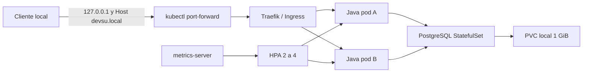

# Kubernetes local: despliegue y defensa tecnica

El despliegue utiliza un cluster kind de un nodo, dos replicas iniciales de Java y PostgreSQL compartido. Todo el acceso de prueba se mantiene en loopback. `devsu.local` es el host de la regla Ingress, no un dominio publicado ni un endpoint de Internet.

## Componentes y decisiones

| Componente | Configuracion | Motivo y limite |
| --- | --- | --- |
| kind 0.33.0 | Kubernetes 1.36.4; nodo por digest; API en 127.0.0.1 | Compatible con kubectl 1.36 local; nodo limitado a 4 GiB y hasta cuatro CPU |
| Java Deployment | Dos replicas; RollingUpdate sin replicas indisponibles | Ambas consultan PostgreSQL. Un solo nodo no proporciona tolerancia al fallo de la maquina |
| PostgreSQL 15.19 | StatefulSet de una replica, PVC de 1 GiB | Identidad estable y datos conservados al reemplazar el pod. Sigue siendo un punto unico de fallo |
| ConfigMap | Perfil postgres, URL JDBC, usuario y puerto | Configuracion no sensible. No contiene la contrasena |
| Secret `devsu-db` | Contrasena aleatoria creada en memoria por el script | Nunca se guarda su manifiesto ni su contenido en evidencia o Git. Base64 no es cifrado |
| Traefik 3.7.16 | Ingress estandar y servicio ClusterIP | Controlador vigente, sin Helm ni CRD adicionales; host `devsu.local`, prefijo `/api` |
| metrics-server 0.9.0 | Metrics API para HPA | Variante para kind con `--kubelet-insecure-tls`; esta excepcion de certificados es solo local |
| HPA autoscaling/v2 | De dos a cuatro replicas; CPU objetivo del 60 % de un request de 100m | Necesita metricas y carga real. Escribir el YAML no prueba que haya escalado |

Las referencias de infraestructura usan etiquetas y digest SHA-256. El instalador kind fija el hash del binario y lo contrasta con el archivo checksum oficial. El nodo kind contiene sus componentes internos; el digest del nodo fija ese conjunto. El helper de aprovisionamiento del volumen tambien se configura con BusyBox por digest. La imagen Java se proporciona al despliegue; en CI se identifica por el commit y se registra el image ID/digest disponible. El script no construye ni sustituye la aplicacion por una imagen ajena.



## Recursos y seguridad

Java solicita 100m CPU y 256 MiB por replica, con limites de 500m y 512 MiB. PostgreSQL solicita 100m y 128 MiB, con limites de 500m y 256 MiB; su pool y conexiones estan acotados. Traefik y metrics-server tienen requests pequenos y limites propios. Son valores iniciales del ejercicio y deben contrastarse con la evidencia y con una carga representativa antes de dimensionar produccion.

Los pods Java ejecutan UID/GID 10001, sin escalamiento de privilegios, sin capabilities, con seccomp RuntimeDefault, raiz de solo lectura y `/tmp` efimero escribible. No montan token de ServiceAccount. PostgreSQL ejecuta UID/GID 999 y monta sus directorios de datos y ejecucion necesarios. Traefik usa ServiceAccount propio: puede observar servicios, endpoints, Ingress y Secrets de `devsu`, y consultar IngressClasses/nodos a nivel de cluster. Ese acceso lo requiere su proveedor Ingress; la aplicacion Java no recibe esos permisos.

Startup y liveness consultan `/api/actuator/health/liveness`. Readiness consulta `/api/actuator/health/readiness`, que incluye la BD. Startup ofrece hasta cuatro minutos para iniciar antes de habilitar liveness. Readiness impide enviar trafico a un pod sin acceso a PostgreSQL; reiniciar todos los pods por una caida compartida de BD no solucionaria esa dependencia.

El PVC local de kind reside en el nodo Docker. Reemplazar el pod de PostgreSQL no elimina el PVC. Eliminar el cluster kind elimina el nodo y puede perder esos datos: no constituye backup ni almacenamiento de produccion.

## Preparacion y despliegue

Se requieren Docker Linux, kubectl y PowerShell 7 en Windows o Linux. No hace falta instalar Java en el host para cargar una imagen ya construida. El instalador guarda kind fuera del repositorio; los scripts usan un kubeconfig exclusivo en el perfil del usuario, separado del kubeconfig habitual.

```powershell
./scripts/Install-Kind.ps1
docker build --progress=plain -t devsu-demo-java:local .
./scripts/Deploy-Kubernetes.ps1 -Image devsu-demo-java:local -LoadImage
./scripts/Test-Kubernetes.ps1
```

`Deploy-Kubernetes.ps1` verifica Docker, instala kind si falta, crea exclusivamente el cluster `devsu` y usa siempre `--kubeconfig ... --context kind-devsu`. No cambia el contexto actual del usuario. Un cluster preexistente sin su marca privada de propiedad no se adopta ni se borra. Asimismo, un namespace preexistente sin la etiqueta de propiedad se rechaza antes de modificarlo.

El kubeconfig predeterminado es `<perfil>/.kube/devsu-kind.config`, fuera del repo. `-Kubeconfig` permite elegir otra ubicacion externa; contiene credenciales y no debe adjuntarse a la entrega. `-EvidenceDirectory` permite conservar cada intento en una carpeta distinta. `-InfrastructureOnly` despliega solo el cluster y los controladores; aun no acredita que la API este desplegada.

En Windows, menos de 3 GiB de RAM libre provoca un rechazo inicial. `-AllowLowMemory` autoriza conscientemente un intento limitado que puede usar paginacion; no cierra aplicaciones del usuario. Para esta maquina, el nodo Docker se acota a 4 GiB. CI es una alternativa si el host no puede sostener el cluster.

La contrasena se genera solo cuando el Secret no existe. Un redespliegue conserva el Secret y el PVC; no cambia automaticamente la contrasena de una base inicializada. Las credenciales no se imprimen ni se pasan en argumentos del proceso. El usuario de BD compartido por migraciones y API es una limitacion heredada del alcance, descrita en [POSTGRESQL.md](POSTGRESQL.md).

## Acceso local mediante Ingress

```powershell
$devsuKubeconfig = Join-Path ([Environment]::GetFolderPath('UserProfile')) '.kube/devsu-kind.config'
kubectl --kubeconfig $devsuKubeconfig --context kind-devsu -n devsu port-forward --address 127.0.0.1 service/traefik 18080:80
```

Mientras ese proceso siga abierto, en otra terminal:

```powershell
Invoke-RestMethod 'http://127.0.0.1:18080/api/users' -Headers @{ Host = 'devsu.local' }
```

La peticion atraviesa Traefik y la regla Ingress. No hay un Service de tipo LoadBalancer, IP publica, apertura en 0.0.0.0 ni requisito de modificar el archivo hosts. Al cerrar el port-forward deja de existir esa entrada local.

## Verificacion y limites de cada prueba

`Test-Kubernetes.ps1` comprueba pods Ready, UID efectivo, escritura temporal, PVC Bound y respuesta HTTP por Ingress. Crea un usuario sintetico directamente en el pod A y consulta ese mismo usuario directamente en B para demostrar datos compartidos. Reemplaza un pod Java, reemplaza el pod PostgreSQL y comprueba el mismo usuario y el mismo UID del PVC. No elimina el PVC ni los datos del ejercicio.

Para HPA espera primero una linea base real de dos replicas con metricas disponibles. Despues crea un Job propio con 16 trabajadores que realizan GET reales a `/api/users`, conserva el historial de CPU/replicas y exige observar mas de dos replicas Ready durante la carga. Los trabajadores informan peticiones exitosas y fallidas. No se utiliza un bucle artificial de CPU dentro de Java. El Job tiene un maximo de 300 segundos de carga; la prueba puede interrumpirlo antes al observar escalamiento y registra el intervalo real en sus comandos/historial. El `sleep` del coordinador solo limita duracion; los trabajadores son quienes envian HTTP.

La limpieza de la prueba termina exclusivamente sus procesos port-forward y elimina su Job de nombre unico. Conserva el cluster y el PVC. `-SkipLoad` permite diagnosticar el resto del flujo, pero deja explicitamente `loadSkipped=true` y no acredita escalamiento observado.

Los resultados reales se documentan en [evidence/kubernetes](evidence/kubernetes/). Un resultado fallido conserva `passed=false` y su error; no se reescribe como aprobado tras corregir un problema. Los archivos de despliegue no equivalen a una ejecucion remota de CI/CD.

## Referencias oficiales

- [kind 0.33.0 y digests de nodos](https://github.com/kubernetes-sigs/kind/releases/tag/v0.33.0), [instalacion](https://kind.sigs.k8s.io/docs/user/quick-start/), [configuracion](https://kind.sigs.k8s.io/docs/user/configuration/).
- [Traefik 3.7.16](https://github.com/traefik/traefik/releases/tag/v3.7.16), [proveedor Kubernetes Ingress y permisos](https://doc.traefik.io/traefik/reference/install-configuration/providers/kubernetes/kubernetes-ingress/).
- [metrics-server 0.9.0](https://github.com/kubernetes-sigs/metrics-server/releases/tag/v0.9.0), [compatibilidad](https://github.com/kubernetes-sigs/metrics-server#compatibility-matrix).
- [HPA y pruebas con carga](https://kubernetes.io/docs/tasks/run-application/horizontal-pod-autoscale-walkthrough/), [probes](https://kubernetes.io/docs/tasks/configure-pod-container/configure-liveness-readiness-startup-probes/), [Secrets](https://kubernetes.io/docs/concepts/configuration/secret/).

## Preguntas de defensa

1. Que garantiza un Deployment con dos replicas y que fallo sigue sin cubrir en un nodo kind?
2. Por que PostgreSQL usa StatefulSet/PVC y Java usa Deployment?
3. Que diferencia hay entre Service, Ingress, controlador Traefik y port-forward? Existe un endpoint publico?
4. Como se diferencian startup, liveness y readiness cuando la BD no esta disponible?
5. Si el objetivo de CPU es 60 % y el request es 100m, sobre que valor calcula HPA ese porcentaje?
6. Que evidencia distingue HPA configurado de HPA que escalo por carga? Que limitaciones tiene este ensayo?
7. Donde esta la contrasena, por que base64 no la cifra y que ocurre al perder el PVC o el nodo?
