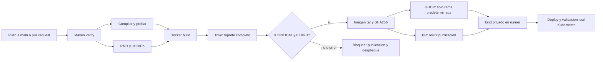

# Pipeline y evidencia

El workflow [ci.yml](../.github/workflows/ci.yml) construye la aplicacion Java del ejercicio, ejecuta los controles de calidad, genera una imagen, publica esa misma imagen en GHCR cuando corresponde y la despliega en un cluster kind del runner. El cluster y la API no tienen endpoint publico. Una ejecucion local y una ejecucion de GitHub Actions son evidencias distintas.

## Flujo



| Job | Que comprueba | Resultado conservado |
|---|---|---|
| `quality` | Java 17, pruebas unitarias offline del gate, compilacion, pruebas Java, empaquetado, PMD, cobertura y umbrales JaCoCo | Log Maven, Surefire, JaCoCo, PMD y `quality-summary.json` |
| `container` | Dockerfile completo y usuario `10001:10001`; escaneo completo y bloqueo ante cualquier CRITICAL/HIGH | Log build, ID de imagen, JSON Trivy y resumen por severidad |
| `publish` | Carga y publica la imagen ya construida; valida SHA256 del archivo transferido | Log push y digest realmente devuelto por Docker |
| `kubernetes` | Despliegue y pruebas del cluster kind privado | Evidencia producida por `Test-Kubernetes.ps1` |

`./mvnw -B -ntp clean verify -DargLine=-Xmx384m` ejecuta el ciclo Maven completo. `compile` precede a `test`, `package` y `verify`; los plugins del POM enlazan PMD y JaCoCo a ese ciclo. Por eso no se ejecutan `compile`, `test` y `verify` como tres builds completos consecutivos. Las reglas y umbrales efectivos estan versionados en [pom.xml](../pom.xml). El Dockerfile vuelve a ejecutar `clean verify` dentro de la etapa de construccion: esto hace verificable la construccion independiente de una imagen, aunque repite trabajo respecto al job `quality`.

La imagen se etiqueta con el SHA de la revision del workflow. Entre jobs se transfiere `docker save` junto con SHA256; tanto publicacion como despliegue cargan ese mismo archivo. En pull requests, GitHub puede usar el commit de integracion generado por GitHub para probar el resultado propuesto.

## Eventos, permisos y credenciales

- `push` a `main`: calidad, imagen, escaneo, GHCR y Kubernetes.
- `pull_request`: calidad, imagen, escaneo y Kubernetes. No publica imagen.
- `workflow_dispatch`: permite ejecutar manualmente. Publica solamente si se elige la rama predeterminada.
- El permiso general es `contents: read`; solamente `publish` solicita `packages: write` y ese job excluye pull requests y ramas diferentes de la predeterminada.
- El token es `GITHUB_TOKEN`, generado por GitHub para la ejecucion. No requiere un PAT guardado en el repositorio. Se suministra a Docker por `--password-stdin` y se elimina la sesion con `docker logout`.
- `checkout` usa `persist-credentials: false`. No hay `pull_request_target`, kubeconfig externo ni secretos de infraestructura para ejecutar codigo de un PR.
- PostgreSQL recibe un Secret generado por los scripts Kubernetes. No se publican manifiestos con contrasenas, kubeconfigs, dumps de `env`, ni salidas `kubectl get secret`.
- Un repositorio publico no hace automaticamente publico un paquete GHCR. La visibilidad del paquete es una configuracion separada. El despliegue del ejercicio usa la imagen transferida y no requiere credenciales del registry dentro del cluster.

## Herramientas fijadas

Las Actions estan fijadas por commit completo, verificado contra los repositorios oficiales al preparar el workflow:

| Action | Version consultada | Commit |
|---|---|---|
| `actions/checkout` | v7.0.1 | `3d3c42e5aac5ba805825da76410c181273ba90b1` |
| `actions/setup-java` | v6.1.0 | `b843ebf9b913146b38da2eaa7aeddf76074ae1ad` |
| `actions/upload-artifact` | v7.0.2 | `cf430e030ddbb5b0abf93d22962f4752f3646cd9` |
| `actions/download-artifact` | v8 | `9000827ccba6bdab643e8b6fd33ac0654aef8333` |

El runner es `ubuntu-24.04`, con PowerShell y Docker del entorno administrado de GitHub. Se fija Temurin `17.0.20.1+1`; el Maven Wrapper fija Maven `3.8.7` y comprueba el SHA256 de la distribucion. Docker y PowerShell del runner reciben mantenimiento de GitHub y no equivalen a un sistema operativo inmutable.

Trivy `0.76.1` se descarga de su release oficial. [Install-Trivy.ps1](../scripts/ci/Install-Trivy.ps1) comprueba un SHA256 fijado en el codigo antes de extraer o ejecutar el binario. Soporta Windows x64 y Linux x64; no ejecuta `curl | sh`. [Install-Kubectl.ps1](../scripts/ci/Install-Kubectl.ps1) fija kubectl `1.36.4` con SHA256 oficial para coincidir con el servidor del ejercicio y evitar depender de la version preinstalada en el runner. Las versiones de kind, Kubernetes y componentes del cluster las fijan sus manifiestos y scripts; consulta [KUBERNETES.md](KUBERNETES.md).

## Politica de vulnerabilidades

La politica actual **bloquea publicacion y despliegue ante cualquier CRITICAL o HIGH**, tenga o no version corregida. El JSON conserva todas las severidades; MEDIUM, LOW y UNKNOWN siguen visibles. No se aplican exclusiones por CVE ni `ignore-unfixed`. Los flags explicitos `--config=` y `--ignorefile=` desactivan la carga automatica de configuracion y exclusiones locales; `--ignore-unfixed=false` conserva hallazgos sin correccion.

Trivy produce primero el JSON completo con `--exit-code 0`. Ese valor permite distinguir errores operativos del escaner de los hallazgos. [Assert-ImageScanPolicy.ps1](../scripts/ci/Assert-ImageScanPolicy.ps1) evalua despues el reporte y devuelve un error si hay CRITICAL/HIGH. Antes de ese error escribe `scan-summary.json`, `trivy-summary.md` y `scan-policy.log`; el JSON original y `trivy.log` permanecen disponibles. El upload del artifact usa `if: always()`. La exportacion de la imagen, GHCR y Kubernetes requieren que el job `container` termine correctamente.

El resumen distingue:

| Campo | Significado |
|---|---|
| `completed` | Trivy termino con codigo 0; no significa que la politica aprobo. |
| `assessmentSucceeded` | Se pudo validar y evaluar el JSON completo. |
| `gatePassed` | La evaluacion fue valida y no encontro CRITICAL/HIGH. |
| `status` | `passed`, `blocked-vulnerabilities`, `operational-error` o `report-error`. |
| `failureKind` | Distingue hallazgos de un fallo operativo o de un reporte invalido. |

Por ejemplo, un escaneo con HIGH termina con `completed=true`, `assessmentSucceeded=true`, `gatePassed=false` y bloquea el flujo. Si falla la descarga de la base de CVE o el proceso Trivy, el pipeline falla sin informar un conteo falso de cero vulnerabilidades. Un reporte ausente o invalido tambien bloquea. No se sobrescribe un `trivy-image.json` existente: repetir el escaneo requiere otra carpeta de evidencia.

[Test-ImageScanPolicy.ps1](../scripts/ci/Test-ImageScanPolicy.ps1) ejecuta ocho pruebas unitarias offline: HIGH sin correccion en un segundo resultado, CRITICAL sin correccion, MEDIUM/LOW/UNKNOWN, reporte vacio valido, error del proceso, JSON invalido, reporte ausente y severidad invalida. Verifica tambien que los resultados se escriban antes de rechazar el gate. Los fixtures estan marcados `unit-test-fixture` y no ejecutan Trivy, Docker ni descargas. La evidencia local esta en [scan-gate](evidence/security-remediation/scan-gate/README.md); no reemplaza un escaneo real de la imagen.

Las ejecuciones historicas [40043825396](evidence/pipeline/remote-run-40043825396/README.md) y [40044688944](evidence/pipeline/remote-run-40044688944/README.md) usaron una politica informativa y conservaron sus hallazgos. Sus resultados permanecen sin alteracion. La correccion del stack y los nuevos resultados se documentan en [SEGURIDAD.md](SEGURIDAD.md). Hasta contar con un nuevo escaneo real no se afirma que la imagen corregida tenga cero CRITICAL/HIGH.

La base de CVE cambia con el tiempo. Cada escaneo conserva la fecha y la version de la herramienta. Despues de ejecutar Trivy captura `trivy-version.json` con la salida real de `trivy --version --format json`, incluyendo las fechas de las bases que esten disponibles en su cache. Aprobar este gate significa cero CRITICAL/HIGH detectados en ese snapshot; no demuestra ausencia de todos los riesgos.

## Ejecutar y revisar GitHub Actions

1. Publicar el repositorio con la rama `main` y Actions habilitado. Si la organizacion restringe Actions o GHCR, ajustar esa politica con el administrador.
2. Abrir la pestana **Actions**, seleccionar **Java quality, image and Kubernetes** y observar los cuatro jobs. Una ejecucion manual desde `main` permite repetir la validacion.
3. Abrir `quality` para leer la salida Maven y descargar el artifact `quality-<run-id>`: Surefire prueba que hubo pruebas; JaCoCo muestra cobertura; PMD muestra analisis estatico.
4. Revisar el artifact `image-evidence-<run-id>` y su JSON Trivy. `publication-<run-id>` contiene el digest publicado cuando hubo publicacion.
5. Revisar `kubernetes-<run-id>` y los resultados de validacion. El runner se destruye despues del job; su API no queda disponible como servicio permanente.
6. Entregar la URL real de la ejecucion, por ejemplo desde **Actions > ejecucion > copiar URL**. Un YAML guardado o una prueba local por si solos no prueban que GitHub haya ejecutado el pipeline.

Los artifacts de evidencia permanecen 14 dias y el archivo pesado que transfiere la imagen permanece 3 dias. Descargar lo necesario antes de su vencimiento. No adjuntar `container-<run-id>` al ZIP del codigo: puede recuperarse desde GHCR cuando sea accesible y no es codigo fuente.

## Pipeline local con los mismos controles

Requiere PowerShell 7.2 o posterior, JDK 17, Git, Docker Engine con contenedores Linux, `kubectl` y acceso a descargas oficiales. Para el cluster completo hay que disponer de memoria suficiente para PostgreSQL, dos JVM, Kubernetes, ingress y metrics-server.

Desde la raiz del repositorio, en Windows:

```powershell
. ./scripts/Use-Java17.ps1
./scripts/ci/Invoke-LocalPipeline.ps1
```

En Linux, seleccionar un JDK 17 en `JAVA_HOME`/`PATH` y ejecutar:

```powershell
./scripts/ci/Invoke-LocalPipeline.ps1
```

El script conserva `pipeline-summary.json`, logs y resultados en `.devsu-local/pipeline-evidence/<fechaUTC>`. Ese directorio esta excluido de Git; no se inventa un commit para etiquetar cambios locales. Por defecto se ejecuta calidad, imagen, Trivy, despliegue y validacion Kubernetes. El cluster local se conserva para inspeccion y no expone un endpoint publico.

Para trabajar por etapas o en una maquina con pocos recursos:

```powershell
./scripts/ci/Invoke-LocalPipeline.ps1 -StopAfter Quality
./scripts/ci/Invoke-LocalPipeline.ps1 -StopAfter Image
```

`requestedScope` y `fullPipelineCompleted` distinguen un alcance parcial de una validacion completa. El script detiene el flujo ante un error real y conserva el resultado disponible; no convierte una etapa pendiente en aprobada.

La publicacion local es opcional y explicita. Definir `GHCR_USER` y `GHCR_TOKEN` solo en el proceso actual mediante el gestor de credenciales elegido, y luego ejecutar:

```powershell
./scripts/ci/Invoke-LocalPipeline.ps1 -PublishImage ghcr.io/propietario/repositorio:etiqueta
Remove-Item Env:GHCR_TOKEN
```

No escribir el token literal en el historial, `.env`, capturas, README ni argumentos de comandos. El script crea un `DOCKER_CONFIG` temporal para esa sesion y lo elimina al terminar; no guarda credenciales en la evidencia. Sin `-PublishImage`, el resumen declara que no se solicito publicacion.

## Limites de la evidencia

- El repositorio contiene automatizacion ejecutable. Solo una ejecucion real y sus resultados permiten afirmar que una etapa aprobo.
- Probar kind en un runner valida Kubernetes; no demuestra disponibilidad continua ni una instalacion de produccion.
- El cluster y PostgreSQL del ejercicio no constituyen una arquitectura de alta disponibilidad ni un plan de backup probado.
- La publicacion GHCR se valida por la respuesta real del registry y su digest; un tag local no prueba un push.
- Los fallos y su resolucion deben conservarse como hechos observados, sin crear fallos deliberados ni simular historiales.

## Preguntas para defender el pipeline

1. Que ejecuta `verify` y por que no hacen falta tres builds Maven consecutivos?
2. Como se demuestra que la imagen publicada y la desplegada corresponden a la construida?
3. Por que un PR puede probar Kubernetes sin recibir permisos para publicar paquetes?
4. Que diferencia hay entre el SHA256 del archivo `docker save`, el ID local de imagen y un digest del registry?
5. Por que Trivy puede terminar con codigo 0 y el gate bloquear el pipeline? Como se distingue ese caso de un error operativo?
6. Que prueba una ejecucion local, que prueba GitHub Actions y que no prueba el cluster efimero?

## Referencias primarias

- [GitHub: publicar imagenes Docker](https://docs.github.com/en/actions/use-cases-and-examples/publishing-packages/publishing-docker-images).
- [GitHub: permisos de GITHUB_TOKEN](https://docs.github.com/en/actions/security-for-github-actions/security-guides/automatic-token-authentication).
- [Checkout: release v7.0.1](https://github.com/actions/checkout/releases/tag/v7.0.1), [Setup Java: release v6.1.0](https://github.com/actions/setup-java/releases/tag/v6.1.0), [Upload Artifact: release v7.0.2](https://github.com/actions/upload-artifact/releases/tag/v7.0.2), [Download Artifact](https://github.com/actions/download-artifact/tree/9000827ccba6bdab643e8b6fd33ac0654aef8333).
- [Trivy: release v0.76.1](https://github.com/aquasecurity/trivy/releases/tag/v0.76.1) y [checksums oficiales](https://github.com/aquasecurity/trivy/releases/download/v0.76.1/trivy_0.76.1_checksums.txt).
